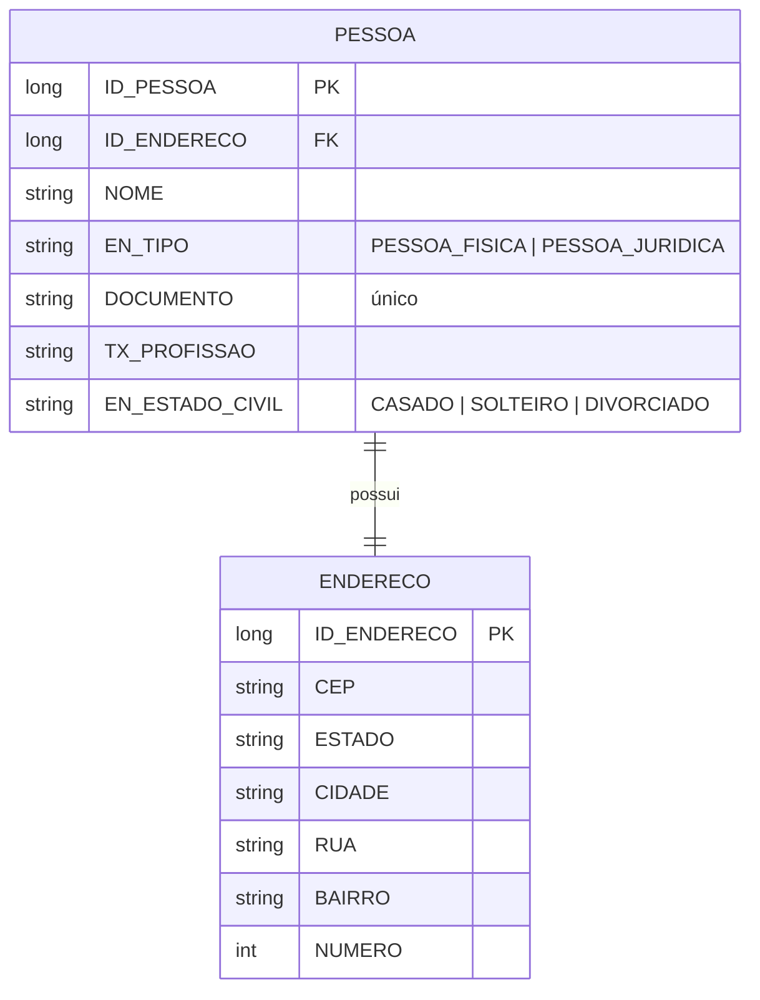

# SGCI API

API REST do **SGCI – Sistema Gerenciador de Cadastro Imobiliário**, responsável pelo cadastro de pessoas físicas e jurídicas e seus endereços.

> 🇬🇧 *REST API for a real-estate registry system (people and addresses), built with Java 17, Spring Boot 3, JPA/Hibernate and MySQL. Includes filtered server-side pagination, CSV export, OpenAPI docs and tests on H2.*

O front-end em Vue.js está em [sgci-front-end](https://github.com/mateusmazevedo/sgci-front-end).

## Funcionalidades

- CRUD completo de pessoas, com endereço vinculado (relação 1:1, salvo em cascata)
- Listagem paginada no servidor, com ordenação e filtros combináveis por nome, documento, tipo, profissão, estado civil, CEP, estado e cidade (JPA Specifications)
- Exportação do cadastro em CSV
- Validação dos dados de entrada com Bean Validation
- Documentação interativa com Swagger UI
- Testes da camada de negócio rodando em banco H2 em memória

## Stack

| Camada | Tecnologia |
| --- | --- |
| Linguagem | Java 17 |
| Framework | Spring Boot 3.2 (Web, Data JPA, Validation) |
| Persistência | Hibernate / JPA, MySQL |
| Mapeamento DTO ↔ entidade | MapStruct |
| Documentação | springdoc-openapi (Swagger UI) |
| Exportação | OpenCSV |
| Testes | JUnit 5, Spring Boot Test, H2 |
| Build | Maven |

## Arquitetura

```
controller/          → endpoints REST e schemas de entrada/saída (Req, Upd, Response, Filter)
controller/schema/   → DTOs e mappers MapStruct
manager/             → regras de negócio, filtros dinâmicos e exportação CSV
repository/          → acesso a dados com Spring Data JPA
model/               → entidades JPA e enums
configuration/       → Swagger e CORS
```

## Modelo de dados



## Endpoints

Base: `http://localhost:8080/v1/api`

| Método | Rota | Descrição |
| --- | --- | --- |
| `POST` | `/pessoas` | Cadastra uma pessoa com endereço e retorna o ID |
| `GET` | `/pessoas` | Lista paginada com filtros (`page`, `size`, `direction`, `ordenarPor` + campos de filtro) |
| `GET` | `/pessoas/{id}` | Busca uma pessoa pelo ID |
| `PUT` | `/pessoas/{id}` | Atualiza os dados de uma pessoa |
| `DELETE` | `/pessoas/{id}` | Remove uma pessoa |
| `GET` | `/pessoas/exportar-csv` | Exporta o cadastro em CSV (conteúdo em Base64) |

Exemplo de listagem:

```
GET /v1/api/pessoas?page=0&size=10&direction=ASC&ordenarPor=nome&cidade=São Luís
```

A documentação completa fica em `http://localhost:8080/v1/api/swagger-ui.html` com a aplicação rodando.

## Como rodar

**Pré-requisitos:** Java 17 e MySQL 8.

1. Crie o banco:
   ```sql
   CREATE DATABASE sgci;
   ```
2. Ajuste usuário e senha em `sgci/src/main/resources/application.properties`.
3. O projeto usa `spring.jpa.hibernate.ddl-auto=none`. Para criar as tabelas automaticamente no primeiro uso local, altere para `update`.
4. Suba a aplicação:
   ```bash
   cd sgci
   ./mvnw spring-boot:run
   ```

## Testes

```bash
cd sgci
./mvnw test
```

Os testes usam o perfil `test`, com banco H2 em memória, e cobrem criação, busca por ID, listagem paginada, atualização e remoção.

## Autor

**Mateus Maciel Azevedo** – Desenvolvedor Full-Stack
[LinkedIn](https://www.linkedin.com/in/mateus-maciel-azevedo-577653163)
